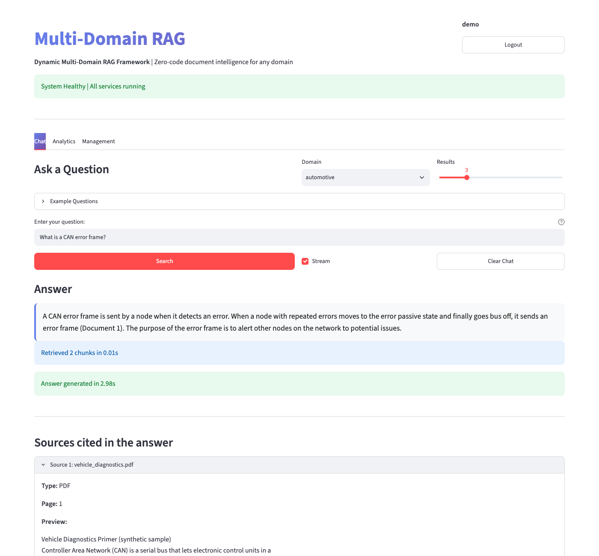

# Multi-Domain RAG

A retrieval-augmented generation (RAG) application for asking questions about documents from different domains, such as technical PDFs and product CSVs, using one shared pipeline. Embeddings, vector search and the language model all run locally, so no document text is sent to an external API.

Each top-level folder under `data/` is a domain. Every chunk is tagged with its domain when it is indexed, and a query can be limited to one domain with a metadata filter. The repository includes two small synthetic domains in `examples/` (automotive PDF, product CSV) so the pipeline can be tried without your own data.

The project has a FastAPI backend, a Streamlit frontend, a command-line chat, JWT-based user accounts, a feedback store and two caches. [Results and Evaluation](#results-and-evaluation) lists what has been checked and what has not.

## How It Works

```
 data/<domain>/*.pdf, *.csv
          |
          |  python -m scripts.index_documents   (or POST /upload)
          v
 chunk -> embed (all-MiniLM-L6-v2, 384-d) -> ChromaDB collection "documents"
          (metadata: domain, source, source_type, page or row)

 Question (Streamlit UI, API client or CLI)
          |
          v
 semantic cache lookup (cosine similarity >= 0.85, same domain)
          | hit: replay the stored answer and sources
          | miss
          v
 hybrid retrieval, optionally filtered by domain
   - vector search in ChromaDB
   - BM25 keyword search (in memory)
   - Reciprocal Rank Fusion of the two rankings
          |
          v
 rerank the top 3*n candidates with the local LLM, keep n (default 3)
          |
          v
 prompt: up to 3 chunks (up to 1000 characters each) + question
          |
          v
 Ollama (llama3.2:3b) generates a short answer, streamed token by token
          |
          v
 answer + sources (file, page or CSV row); the answer is stored in the semantic cache
```

PDFs are split into 1000-character chunks with 200 characters of overlap, and each chunk keeps its file and page. For CSV files, each row becomes one document built from the text columns, with the other columns stored as metadata.

The prompt tells the model to answer only from the supplied context, to cite document numbers, and to say it does not have enough information otherwise.

## Implementation

**Ingestion** ([rag/ingestion/](rag/ingestion/), [scripts/index_documents.py](scripts/index_documents.py)).
The indexer scans the data directory and treats every subfolder that contains PDFs or CSVs as a domain. It embeds chunks in batches of 32 and writes them to a persistent ChromaDB collection with random UUIDs as IDs. Running it again asks before dropping and rebuilding the collection. `POST /upload` indexes one new file without touching existing data.

**Retrieval** ([rag/retrieval/hybrid_search.py](rag/retrieval/hybrid_search.py)).
Vector search uses ChromaDB, and the query is embedded with the same sentence-transformers model that embedded the documents (the query vector is passed to Chroma; Chroma's own default embedder is never used). Keyword search uses `rank_bm25` over lowercase word tokens with punctuation removed and a short list of common English words ("the", "is", "of") dropped, for documents and queries alike. Documents that share no term with the query are dropped instead of being returned with a score of zero. The two ranked lists are merged with Reciprocal Rank Fusion (k = 60). The domain filter applies to both. The BM25 index is built in memory from the collection when the search engine is created. It is not saved to disk. Before each request the API compares the live collection (id and document count) with the one the engine was built from, and rebuilds the engine and clears the caches if they differ. That covers uploads, deletions and re-indexing done by `scripts.index_documents` while the API is running.

**Reranking** ([rag/retrieval/reranker.py](rag/retrieval/reranker.py)).
The candidates are shown to the local LLM, which is asked to return the numbers of the best chunks. If the call fails or the reply cannot be parsed, the retrieval order is kept. This is prompt-based ranking, not a trained cross-encoder, and In the benchmark below it did not clearly improve retrieval.

**Generation** ([rag/qa_chain.py](rag/qa_chain.py)).
Answers come from the Ollama HTTP API, limited to 150 generated tokens. The API warms the model at startup. The same model is used for reranking and answering. The prompt and the source list are built by one function each, shared by the streaming and non-streaming paths. If retrieval finds nothing, the API returns a fixed "not enough information" answer without calling the LLM. Each source in a response has a `cited` flag, set when the answer names that document ("Document 2"); a refusal cites nothing, and chunks beyond the three in the prompt can never be cited. The UI and CLI list cited sources first and show the rest as "also retrieved, not cited". Error messages from this layer start with `[LLM error]` and are never cached. If Ollama fails during a streamed answer, the error is sent in the stream.

**Backend** ([api/main.py](api/main.py)).
Endpoints: `/query` (NDJSON stream or a single JSON response), `/search` (retrieval only), `/domains`, `/health`, `/feedback`, `/feedback/stats`, `/feedback/export`, `/upload`, `/domain/{name}`, `/auth/register`, `/auth/login`, `/auth/me`. Rate limits are per client IP: 10 per minute for `/query`, 20 for `/search`, 30 for `/feedback`, 5 for `/upload`.

**Frontend** ([frontend/app.py](frontend/app.py)).
A Streamlit app with login and registration, a chat tab with a streaming toggle and thumbs up/down feedback, an analytics tab, and a management tab for uploading files and deleting domains. Answers served from the semantic cache are marked "Cached response" with the similarity and the matched question.

**Authentication** ([rag/auth.py](rag/auth.py)).
Users are stored in `storage/users.json` with bcrypt hashes. `/auth/login` returns a JWT (HS256, 24 hour lifetime). `/upload`, `/domain/{name}` and `/auth/me` require a token. The other endpoints, including `/query`, do not. The Streamlit app asks for a login before showing the chat, but the API does not enforce it on `/query`. The signing secret is the `JWT_SECRET` environment variable if set. Otherwise a random secret is generated on first use and stored in `storage/jwt_secret` (mode 0600), so tokens survive a restart. The Streamlit cookie password is derived from the same secret.

**Caching** ([rag/caching/](rag/caching/)).
- The semantic cache ([semantic_cache.py](rag/caching/semantic_cache.py)) stores the query embedding, answer and sources. A new question is a hit when its cosine similarity to a cached question in the same domain is at least 0.85 and the retrieval settings (search method, `n_results`, reranking) are the same. It holds up to 1000 entries, evicts the least recently accessed, and is saved to `storage/semantic_cache.json`. Both streaming and non-streaming answers are stored. A hit on a streaming request is replayed in the same NDJSON format as a live answer. The cache is cleared whenever the API detects that the documents changed.
- `QueryCache` ([cache_manager.py](rag/caching/cache_manager.py)) is an exact-match cache with a one hour TTL, used by `ask_question()` in the CLI and the non-streaming API path.

**Configuration** ([rag/config.py](rag/config.py)).
All paths and URLs live in one module and can be set with environment variables:

| Variable | Default | Meaning |
|----------|---------|---------|
| `RAG_DATA_DIR` | `./data` | one subfolder per domain |
| `RAG_STORAGE_DIR` | `./storage` | ChromaDB, users, caches, feedback, JWT secret |
| `OLLAMA_URL` | `http://localhost:11434` | Ollama server |
| `LLM_MODEL` | `llama3.2:3b` | model used for reranking and answers |
| `API_URL` | `http://localhost:8000` | API address used by the Streamlit app |
| `JWT_SECRET` | generated | token signing secret |

**Containers** ([Dockerfile](Dockerfile), [docker-compose.yml](docker-compose.yml)).
Compose runs the API and the UI in two containers built from one image, mounts `data/` and `storage/`, and reaches Ollama on the host through `host.docker.internal`. An optional `ollama` service is available through the `ollama` profile. See [Results and Evaluation](#results-and-evaluation) for what has been verified.

## Results and Evaluation

**Automated tests.** There are 230 tests in 18 files under `tests/`. On 31 October 2026, on a fresh virtualenv built with `pip install -r requirements.txt` (Python 3.13, macOS arm64, sentence-transformers 5.7.0, torch 2.15.0, ChromaDB 0.5.23, Streamlit 1.66.1): 230 passed, 0 failed, 0 skipped. That includes `test_embeddings.py` and `test_vector_store.py`, which load the real `all-MiniLM-L6-v2` model, and the evaluation tests that read the downloaded NIST PDFs. The CI workflow runs the same suite, but I could not see its run history, and it would skip the PDF-based evaluation tests unless the PDFs are downloaded first.

**Real versus mocked.** Most tests mock the slow parts: embeddings are deterministic fake vectors and Ollama is replaced by a fake that records prompts and returns canned text. These parts are real in those tests: PDF and CSV loading, ChromaDB (a real collection in a temporary directory), BM25, Reciprocal Rank Fusion, reranker reply parsing, prompt and source building, the NDJSON protocol, the caches, the CLI loop with scripted input, and the FastAPI app through `TestClient`. They show that the pipeline is wired correctly and that source attribution, domain filtering and failure handling behave as designed. Only `test_embeddings.py`, `test_vector_store.py` and the smoke test below run a real model.

**Real-model smoke test.** I ran the whole pipeline with no mocks on the two example domains (32 documents) using the real `all-MiniLM-L6-v2` embeddings, ChromaDB, BM25 with RRF, and Ollama 0.13.3 with `llama3.2:3b`. It covered the indexer, the API (streaming, non-streaming, cache hit and miss, `/search`, registration, login, upload, delete), the command-line chat, and a re-index done by the CLI while the API was running.
- Worked: indexing (32 documents), domain filtering for all three search methods and both domains, source attribution (file and page for PDF, file and row for CSV), reranking, streaming and non-streaming answers, refusal on questions with no answer in the data ("What is the capital of France?"), a cache hit on a paraphrase (cosine similarity 0.969 for one pair), no hit when `n_results` differs, upload and delete without a restart, and pickup of a CLI re-index by the running API.
- Embedding check: for 6 sample texts, the sentence-transformers vectors and ChromaDB's default ONNX vectors had a cosine similarity of 1.0000 (rounded to four decimals) and gave the same rankings. So the old query path was inconsistent in design, but I measured no practical difference on these samples.
- Latency, single runs on one laptop, not benchmarks: 1.3 to 3.7 seconds per question once warm (about 1.5 seconds more with reranking), and 7 seconds for the first question including loading the embedding model.
- Failures found and fixed: the installed Streamlit (1.66.1) no longer has `st.cache`, which `streamlit-cookies-manager` still uses, so the frontend crashed on import (fixed with a small compatibility line in `frontend/app.py`, with a regression test that runs the script in Streamlit's headless test runner). A newer `posthog` made ChromaDB log an error on every client start (fixed by pinning `posthog<6` and turning telemetry off on the client). The indexer printed a stale "run main.py" hint.
- Failures found in this first run and fixed afterwards: the 300-character prompt limit (a wrong answer to "What is a CAN error frame?"), keyword matches on common words, all retrieved chunks being shown as sources, and the CLI function that could kill other processes (removed). After these fixes I repeated the real-model run: the error-frame answer was correct, refusals cited no source, and the cited flags matched the documents the answers named. One failure remains: the 3B reranker dropped the correct chunk when the same question was asked without a domain filter (see Limitations).
- Not checked in this run: any answer-quality measurement. The Streamlit UI was checked later in a real browser (see Streamlit UI below).

**Coverage.** Line coverage from the 230-test run on 31 October 2026: `rag/ingestion/csv_loader.py` 100%, `rag/retrieval/hybrid_search.py` 98%, `rag/retrieval/vector_store.py` 96%, `rag/auth.py` 94%, `rag/caching/semantic_cache.py` 92%, `rag/feedback_manager.py` 91%, `rag/caching/cache_manager.py` 90%, `rag/qa_chain.py` 79%, `rag/retrieval/reranker.py` 64%, `api/main.py` 57%, `scripts/chat_cli.py` 39%, `scripts/index_documents.py` 19%. Combined for `rag/`, `api/` and `scripts/`: 68%. The Streamlit frontend is not measured. Coverage shows which lines ran, not that answers are correct.

**What the tests check about the earlier problems.**
- Semantic cache: a streamed answer is stored, a paraphrase then returns an NDJSON stream with `cache_hit` set and does not call the LLM, and empty answers and LLM errors are not stored. These tests fail when the two fixes are removed.
- BM25: a new engine sees documents that were added, deleted or updated in place, and a keyword query with no matching term returns nothing instead of arbitrary documents (tests use a real ChromaDB collection).
- Embedding consistency: the query vector passed to Chroma is the same function's output that was stored for the documents, and no code path passes `query_texts` to Chroma. These tests fail if the old call is restored.
- Changes made outside the API: a collection recreated, or documents added, behind the API's back is picked up on the next request.
- Cache key: an answer cached with one `n_results`, search method or reranking setting is not returned for another.
- Streaming and non-streaming `/query` return the same sources and send the same prompt. No-result queries do not call the LLM, and an Ollama failure during streaming is reported in the stream and not cached.
- CSV domain metadata: every CSV document carries its domain, and a ChromaDB domain filter returns only that domain.
- JWT secret: environment override, persistence across a simulated restart, file permissions. I also started the real API server, logged in, restarted it, and the same token was still accepted.

**Semantic cache accuracy.** The cache unit tests use hand-written 4-dimensional vectors, so they check the threshold logic, not how often real paraphrases match at 0.85. I have not measured that.

**Retrieval benchmark.** One run of `python -m eval.run_retrieval --split all --final` on 31 October 2026 compared four configurations on the 25 answerable questions in `eval/questions.jsonl` (the 5 unanswerable questions have no retrieval metric). Data: four NIST publications (253 pages, 797 chunks) and 2,607 EPA vehicle records (model years 2023 and 2024), indexed with the application's own ingestion. Machine: macOS arm64, Python 3.13.7, `all-MiniLM-L6-v2`, `llama3.2:3b` through Ollama 0.13.3. The raw output, with package versions, data checksums and per-question rankings, is `eval/results/retrieval_all_20261031T221011.json`. Details of the question set, ground truth and metrics are in [eval/README.md](eval/README.md).

Configurations: `bm25`, `vector` and `hybrid` (BM25 plus vector with Reciprocal Rank Fusion) each return 10 results. `hybrid_rerank` takes 9 hybrid candidates, reorders them with the local LLM and keeps 3, as the API does. Only @1 and @3 are comparable across all four.

Document questions (15 questions, span recall is the share of gold evidence spans covered by the top k chunks):

| Configuration | recall@1 | recall@3 | recall@10 | MRR@3 | Latency median / p95 (ms) |
|---------------|----------|----------|-----------|-------|----------------------------|
| bm25 | 0.33 | 0.45 | 0.65 | 0.40 | 3 / 18 |
| vector | 0.27 | 0.28 | 0.65 | 0.30 | 14 / 55 |
| hybrid | 0.15 | 0.55 | 0.72 | 0.39 | 17 / 57 |
| hybrid_rerank | 0.20 | 0.53 | not applicable | 0.33 | 1,100 / 1,786 |

Vehicle questions, exact and semantic (6 questions, precision@3 is the share of the top 3 rows that match the gold row set):

| Configuration | precision@3 | precision@10 | MRR@3 | Latency median / p95 (ms) |
|---------------|-------------|--------------|-------|----------------------------|
| bm25 | 0.78 | 0.67 | 0.83 | 9 / 57 |
| vector | 0.17 | 0.25 | 0.31 | 235 / 277 |
| hybrid | 0.39 | 0.47 | 0.50 | 193 / 218 |
| hybrid_rerank | 0.67 | not applicable | 0.64 | 1,481 / 2,130 |

What the numbers show, and what they do not:
- On these questions, reranking with the 3B model did not clearly help on documents (recall@3 0.53 against 0.55 for hybrid alone) and added about one second per query. On vehicle rows it scored higher than hybrid at 3 results but lower than BM25 alone.
- BM25 alone was the strongest or close to it on both sets. Vector search was weakest on vehicle rows, whose text is short lists of `name: value` lines.
- The 4 vehicle questions that need counts, maxima or averages are reported in the JSON as informational. Retrieval cannot answer them, because the numeric columns are not in the indexed text.
- The sample is small: 15 and 6 questions. A difference of one question moves a mean by 0.07 and 0.17 respectively, so most gaps between configurations above are within noise. No confidence intervals were computed.
- Single run. Rankings come from the first of three timed repeats per query; reranking is not fully deterministic (temperature 0.1), and I did not measure run-to-run variation. Latency is wall time on one laptop and is comparable only within this run. The embedding model was warmed up before timing, and Ollama was already loaded.
- The 10 development questions and 20 held-out questions were run together, and two development questions (D07 and V07) were reworded for ambiguity before this run. Nothing was tuned on the results.
- Answer quality (the generated text) was not evaluated. The planned human review in `eval/` has not been done.
- The numbers describe these four NIST documents and this EPA snapshot. They do not show how the pipeline behaves on other data.

**Cache and end-to-end latency.** I have no benchmark of cache-hit time. A cache hit skips retrieval, reranking and generation, so it is faster than a full query, but I have not measured by how much. A full query makes two sequential LLM calls (reranking and generation).

**Answer quality.** Not evaluated. The files in `examples/` are synthetic and tiny (2 PDF pages and 30 product rows). They are for checking that the pipeline runs and are not evidence of retrieval quality.

**Docker.** `docker compose config` validates the current compose file. The Docker daemon was not running when I checked, so I did not build the image or start the containers. The image installs PyTorch through `sentence-transformers`, so the build is large. Container behavior is unverified.

**Streamlit UI.** On 31 October 2026 I ran the real API, Streamlit and Ollama locally and drove the UI in Google Chrome (through Playwright, headless): register, log in, choose the `automotive` domain, ask "What is a CAN error frame?" and read the streamed answer and sources. It worked, and the screenshot below comes from a second run after the source display change (file name only, pages from 1). The run used the two example domains (32 documents) and a temporary storage directory. It found one bug: `streamlit run frontend/app.py` failed with `ModuleNotFoundError: No module named 'rag'`, because Streamlit puts the script folder on the path, not the repository root. The README and `docker-compose.yml` now use `python -m streamlit run frontend/app.py`, which works, and is what `start_services.sh` already used. I did not check the Analytics and Management tabs, the feedback buttons, upload and delete in the browser, or the cached-response banner on a fresh run (I saw it once on a repeated question).



**Local inference.** Generation, reranking and embeddings run locally, so the pipeline makes no paid API calls. It still needs a machine that can run a 3B model.

## Running Locally

### Prerequisites

- Python 3.11 or newer (CI uses 3.11)
- [Ollama](https://ollama.com/) running on port 11434
- Network access on the first run: `pip install` pulls in PyTorch through `sentence-transformers`, and the embedding model is downloaded on first use

### Setup

```bash
git clone https://github.com/miraccanince/multi-domain-rag.git
cd multi-domain-rag
python3 -m venv venv
source venv/bin/activate
pip install -r requirements.txt

ollama pull llama3.2:3b
```

### Index documents

`data/` is git-ignored. To try the sample domains, copy them in. For your own documents, create one folder per domain with PDFs or CSVs in it.

```bash
mkdir -p data
cp -r examples/automotive examples/products data/

python -m scripts.index_documents                 # all domains
python -m scripts.index_documents --domain products
python -m scripts.index_documents --yes           # skip the overwrite prompt
```

The indexer rebuilds the whole collection each time. A running API notices the change on its next request.

### Start the services

```bash
# terminal 1: API on http://localhost:8000 (interactive docs at /docs)
uvicorn api.main:app --port 8000

# terminal 2: UI on http://localhost:8501
python -m streamlit run frontend/app.py
```

[start_services.sh](start_services.sh) starts both and expects the virtualenv at `./venv`. Register an account in the UI before using the chat tab. For the command-line chat, run `python -m scripts.chat_cli` (commands: `/switch`, `/llm`, `/rerank`, `/stats`, `/cache`, `/perf`, `/help`, `/quit`).

### Docker (not verified end to end, see Results)

```bash
docker compose up --build
docker compose run --rm api python -m scripts.index_documents --yes
```

This expects Ollama running on the host. To run Ollama in a container instead, use `OLLAMA_URL=http://ollama:11434 docker compose --profile ollama up --build` and pull the model with `docker compose exec ollama ollama pull llama3.2:3b`.

### Example questions

- Automotive sample: "What is a CAN error frame?", "What does the code P0301 mean?"
- Product sample: "Which products are waterproof?", "Show me a floral dress."

### Adding a domain

Create `data/<name>/`, add PDFs or CSVs, and re-run the indexer, or upload a file in the management tab. No code changes are needed. For CSV files, text columns are detected automatically. The domain named `fashion` is special: it expects the columns `BrandName`, `Deatils`, `Sizes`, `Category`, `MRP`, `SellPrice` and `Discount`. Use another domain name for CSVs with different columns.

## Testing

```bash
pytest tests/ -v
pytest tests/ --cov=rag --cov=api --cov-report=term
```

`test_embeddings.py` and `test_vector_store.py` load the sentence-transformers model, so the first run needs network access. The other files need no model, no Ollama and no running service. Tests write to a temporary storage directory, never to your `storage/`. See [tests/README.md](tests/README.md) for the file-by-file breakdown.

## Project Structure

```
rag/
  config.py             paths, URLs and settings (environment overridable)
  ingestion/            pdf_loader.py, csv_loader.py
  retrieval/            embeddings.py, vector_store.py, hybrid_search.py, reranker.py
  caching/              semantic_cache.py, cache_manager.py
  qa_chain.py           retrieve, rerank and generate (CLI and non-streaming API)
  auth.py               user store, bcrypt hashing, JWT helpers, signing secret
  feedback_manager.py   feedback storage, statistics, CSV/JSON export
api/main.py             FastAPI app
frontend/app.py         Streamlit UI
scripts/                index_documents.py, chat_cli.py (run with python -m scripts.<name>)
examples/               synthetic sample domains: automotive (PDF), products (CSV)
tests/                  pytest suite
eval/                   retrieval and answer evaluation (data sources, questions, tooling); see eval/README.md
docs/feedback.md        feedback system notes
Dockerfile, docker-compose.yml, start_services.sh, requirements.txt, pytest.ini
.github/workflows/tests.yml
```

Generated at runtime and git-ignored: `data/` (your documents) and `storage/` (ChromaDB in `chroma/`, `users.json`, `semantic_cache.json`, `feedback.json`, `jwt_secret`).

## Limitations

- **Semantic cache.** It is keyed on question, domain and retrieval settings, but not on the model or the prompt. Clear `storage/semantic_cache.json` after changing either. Entries written by earlier versions have no settings and are never reused.
- **Change detection** compares the collection id and document count. It would miss an in-place edit that keeps both the same, but no code path in this project edits documents in place.
- **Existing indexes.** Vectors already stored in ChromaDB were produced by sentence-transformers and are unaffected by the query-side fix, so no re-indexing is needed.
- **Reranking is unreliable with the 3B model.** In smoke tests it dropped the correct PDF chunk, which hybrid search had ranked first, in favor of unrelated products (the same result in three repeated runs for "What is a CAN error frame?" without a domain filter). The reranking path is on by default in the API. In the benchmark above it did not clearly improve retrieval over hybrid search alone and added about one second per query; consider turning it off.
- **Cross-domain questions.** With no domain filter, hybrid search mixes documents from all domains, and PDF chunks and short product rows compete in one ranking.
- **Vehicle-style CSV rows lose their numbers.** The CSV loader puts only text columns into the document text. Numeric columns (such as year or MPG) are stored as metadata and are not searchable or visible to the LLM. Questions that need counts, maxima, averages or numeric thresholds cannot be answered reliably by retrieval in any case.
- **Source display.** Responses, the UI and the CLI show the file name only and count PDF pages from 1. ChromaDB still stores the full path and the 0-based page, and the evaluation ground truth is unchanged. Semantic cache entries written before this change keep the old path and page, so clear `storage/semantic_cache.json` after upgrading.
- **Answer length.** Answers are capped at 150 generated tokens.
- **Common-word filtering is minimal.** The stop-word list is short and English only. A question made only of common words returns no keyword results, while vector search still returns its nearest chunks, so the LLM sees unrelated text and has to refuse.
- **Access control is minimal.** Registration is open, any logged-in user can upload and delete domains, `/query`, `/search` and `/feedback/export` need no token, and CORS allows all origins. Passwords are limited to 72 bytes by bcrypt. Password hashes that were committed to this repository's history before they were untracked should be treated as compromised.
- **File-based storage.** Users, feedback and the semantic cache are JSON files, which is fine for one process and not for several API workers.
- **`fashion` CSV columns are hard-coded** (see above).
- **Not evaluated** for answer quality, load or security (retrieval was measured on a small question set, see Results), and no license file is included.

## Author

Mirac Can Ince
