# AI-Powered Lead Management & Qualification Workflow
## Technical Flowchart — Cleeng B2B SaaS

---

## Visual Flowchart (Mermaid)

```mermaid
flowchart TD
    %% ===== RENK TANIMLARI =====
    %% Mavi = Geleneksel Otomasyon
    %% Mor = AI Bileşenleri
    %% Sarı = İnsan Müdahalesi (Human-in-the-Loop)
    %% Yeşil = Aksiyonlar

    %% ===== TETIKLEME — LEAD GİRİŞİ =====
    subgraph TRIGGER["🔵 TRIGGER: New Lead Entry"]
        direction LR
        S1["📹 Webinar\nRegistration"]
        S2["💼 LinkedIn\nAds"]
        S3["🎯 Demo\nRequest"]
        S4["📄 Content\nDownload"]
    end

    %% ===== ADIM 1 — VERİ NORMALİZASYON =====
    TRIGGER --> STEP1

    subgraph STEP1["🔵 STEP 1: Data Normalization & Deduplication"]
        direction TB
        N1["📋 Field Standardization\n─────────────────\n• Ad/Soyad → full_name\n• Şirket adı normalize\n• Telefon formatı E.164\n• Ülke → ISO 3166"]
        N2["🔍 Deduplication Engine\n─────────────────\n• Email exact match\n• Şirket domain fuzzy match\n• Levenshtein distance ≤ 2\n• Mevcut lead → merge"]
        N3["✅ Validation Layer\n─────────────────\n• Email: MX record check\n• Domain: WHOIS lookup\n• Disposable email filter\n• Bot/spam detection"]
        N1 --> N2 --> N3
    end

    %% ===== ADIM 2 — AI ARAŞTIRMA & ZENGİNLEŞTİRME =====
    STEP1 --> STEP2

    subgraph STEP2["🟣 STEP 2: AI Research & Enrichment Agent"]
        direction TB
        R1["🏢 Company Intelligence\n─────────────────\n• Sektör & alt sektör\n• Çalışan sayısı\n• Yıllık gelir aralığı\n• Fonlama durumu\n• Teknoloji stack"]
        R2["📊 Intent Signal Extraction\n─────────────────\n• Web sitesi teknoloji analizi\n• LinkedIn aktivite tarama\n• İçerik tüketim kalıpları\n• Rakip ürün kullanımı\n• İş ilanları analizi"]
        R3["📦 Structured JSON Output\n─────────────────\n{\n  company_profile: {...},\n  intent_signals: [...],\n  tech_stack: [...],\n  enrichment_confidence: 0.92\n}"]
        R1 --> R2 --> R3
    end

    %% ===== ADIM 3 — AI PUANLAMA MOTORU =====
    STEP2 --> STEP3

    subgraph STEP3["🟣 STEP 3: AI Lead Scoring Engine (0-100)"]
        direction TB
        SC1["🎯 ICP Fit Score (0-40)\n─────────────────\n• Sektör uyumu: 0-10\n• Şirket büyüklüğü: 0-10\n• Bölge: 0-10\n• Teknoloji uyumu: 0-10"]
        SC2["🔥 Intent Score (0-35)\n─────────────────\n• Web sitesi ziyaret sıklığı: 0-10\n• İçerik indirme: 0-10\n• Demo talep sinyali: 0-10\n• Rakipten geçiş sinyali: 0-5"]
        SC3["📈 Behavioral Score (0-25)\n─────────────────\n• Email açılma/tıklama: 0-10\n• Webinar katılım: 0-5\n• Fiyat sayfası ziyareti: 0-5\n• Chatbot etkileşimi: 0-5"]
        SC4["🧮 Final Score Calculation\n─────────────────\nTotal = ICP + Intent + Behavioral\nConfidence = model_certainty\nOutput: {score: 85, confidence: 0.91}"]
        SC1 --> SC4
        SC2 --> SC4
        SC3 --> SC4
    end

    %% ===== KARAR NOKTASI =====
    STEP3 --> VALIDATE{"🟣 Confidence\n≥ 0.75?"}

    VALIDATE -->|"❌ HAYIR\nConfidence < 0.75"| HUMAN_REVIEW
    VALIDATE -->|"✅ EVET"| DECISION

    subgraph HUMAN_REVIEW["🟡 Human Review Queue"]
        HR1["👤 Analyst Review\n─────────────────\n• Enrichment verisi kontrolü\n• Manuel araştırma\n• Skor düzeltme\n• Override + sebep notu"]
    end

    HUMAN_REVIEW --> DECISION

    DECISION{"🟣 Score ≥ 80\nAND\nConfidence ≥ 0.75?"}

    %% ===== SICAK LEAD YOLU =====
    DECISION -->|"🔥 EVET — Hot Lead"| HOT_PATH

    subgraph HOT_PATH["🟣 AI Personalized Outreach Generation"]
        direction TB
        O1["📧 Email Draft\n─────────────────\n• Kişiselleştirilmiş konu satırı\n• Şirket-spesifik değer önerisi\n• Cleeng kullanım senaryosu\n• Sosyal kanıt (benzer müşteri)\n• Net CTA"]
        O2["💬 LinkedIn Message\n─────────────────\n• Bağlantı isteği notu\n• Sektöre özel açılış\n• Kısa değer önerisi\n• Toplantı önerisi"]
        O3["📱 Multi-Channel Sequence\n─────────────────\n• Gün 1: Email\n• Gün 3: LinkedIn bağlantı\n• Gün 5: Follow-up email\n• Gün 7: LinkedIn mesaj\n• Gün 10: Telefon"]
        O1 --> O3
        O2 --> O3
    end

    HOT_PATH --> SALES_REVIEW

    subgraph SALES_REVIEW["🟡 Sales Review & Edit"]
        SR1["👤 Sales Rep Review\n─────────────────\n• AI taslak onayı/düzenlemesi\n• Kişisel dokunuş ekleme\n• Zamanlama ayarı\n• Onay → Gönder"]
    end

    SALES_REVIEW --> ASSIGN

    subgraph ASSIGN["🟢 Assign to Sales Rep"]
        A1["🎯 Smart Routing\n─────────────────\n• Bölge eşleştirme\n• Sektör uzmanlığı\n• Kapasite dengeleme\n• Round-robin fallback"]
    end

    %% ===== SOĞUK/ILIK LEAD YOLU =====
    DECISION -->|"❄️ HAYIR — Nurture"| NURTURE_PATH

    subgraph NURTURE_PATH["🔵 Automated Nurture Workflow"]
        direction TB
        NR1["📊 Segment Classification\n─────────────────\n• Score 60-79: Warm → Accelerated nurture\n• Score 40-59: Cool → Standard nurture\n• Score < 40: Cold → Long-term drip"]
        NR2["📧 Email Sequence Engine\n─────────────────\n• Segment-bazlı içerik\n• Eğitim içerikleri\n• Case study'ler\n• Webinar davetleri\n• Cleeng blog içerikleri"]
        NR3["🔄 Re-Engagement Monitor\n─────────────────\n• Yeni etkileşim tespit\n• Skor güncelleme tetikle\n• Threshold aşımı → Hot path'e taşı\n• 90 gün inaktif → Arşivle"]
        NR1 --> NR2 --> NR3
    end

    NR3 -->|"📈 Yeni etkileşim\nRe-score tetikle"| STEP3

    %% ===== FİNAL AKSİYONLAR =====
    ASSIGN --> FINAL_ACTIONS
    NURTURE_PATH --> FINAL_ACTIONS

    subgraph FINAL_ACTIONS["🟢 Final Actions & Integrations"]
        direction TB
        F1["💾 CRM Update\n─────────────────\n• HubSpot/Salesforce sync\n• Lead stage güncelleme\n• Tüm enrichment verisi\n• Aktivite timeline"]
        F2["📊 Analytics & Logging\n─────────────────\n• Scoring verisi kaydet\n• Conversion tracking\n• Model performans metrikleri\n• A/B test sonuçları"]
        F3["🔔 Notifications\n─────────────────\n• Slack: #sales-leads kanalı\n• Hot lead → Acil bildirim\n• Günlük özet rapor\n• Weekly pipeline review"]
        F4["🗄️ Data Warehouse\n─────────────────\n• Enrichment verisi sakla\n• Scoring geçmişi\n• Outreach performansı\n• Churn prediction feedback"]
        F1 --> F2 --> F3 --> F4
    end

    %% ===== STİL TANIMLARI =====
    classDef trigger fill:#2196F3,stroke:#1565C0,color:#fff,stroke-width:2px
    classDef traditional fill:#BBDEFB,stroke:#1976D2,color:#0D47A1,stroke-width:2px
    classDef ai fill:#CE93D8,stroke:#7B1FA2,color:#4A148C,stroke-width:2px
    classDef human fill:#FFF9C4,stroke:#F9A825,color:#E65100,stroke-width:2px
    classDef action fill:#A5D6A7,stroke:#2E7D32,color:#1B5E20,stroke-width:2px
    classDef decision fill:#E1BEE7,stroke:#7B1FA2,color:#4A148C,stroke-width:3px

    class TRIGGER trigger
    class STEP1 traditional
    class STEP2,STEP3,HOT_PATH ai
    class HUMAN_REVIEW,SALES_REVIEW human
    class ASSIGN,FINAL_ACTIONS action
    class VALIDATE,DECISION decision
    class NURTURE_PATH traditional
```



---

## Renk Kodlaması Açıklaması

| Renk | Kategori | Açıklama |
|------|----------|----------|
| 🔵 Mavi | Geleneksel Otomasyon | Kural tabanlı, deterministik süreçler |
| 🟣 Mor | AI Bileşenleri | LLM, RAG, ML tabanlı akıllı süreçler |
| 🟡 Sarı | Human-in-the-Loop | İnsan müdahalesi gereken karar noktaları |
| 🟢 Yeşil | Aksiyonlar | Sistem entegrasyonları ve son işlemler |

---

## Akış Özeti

```
Lead Girişi (4 kaynak)
    │
    ▼
[🔵 Normalizasyon & Tekilleştirme]
    │
    ▼
[🟣 AI Araştırma & Zenginleştirme — RAG Agent]
    │
    ▼
[🟣 AI Puanlama Motoru (0-100)]
    │
    ├── Confidence < 0.75 ──→ [🟡 İnsan İnceleme] ──┐
    │                                                  │
    ▼                                                  ▼
{Score ≥ 80 AND Confidence ≥ 0.75?}
    │                    │
    ▼ EVET               ▼ HAYIR
[🟣 AI Outreach]     [🔵 Nurture Workflow]
    │                    │
    ▼                    ├── Re-engagement → Re-score ──→ [🟣 Puanlama]
[🟡 Sales Review]       │
    │                    │
    ▼                    │
[🟢 Rep Atama]          │
    │                    │
    ▼                    ▼
[🟢 CRM + Analytics + Slack + Data Warehouse]
```
